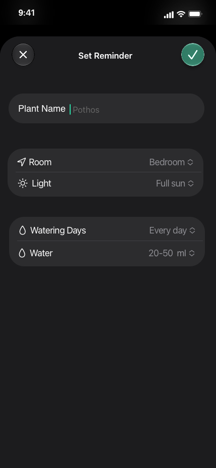
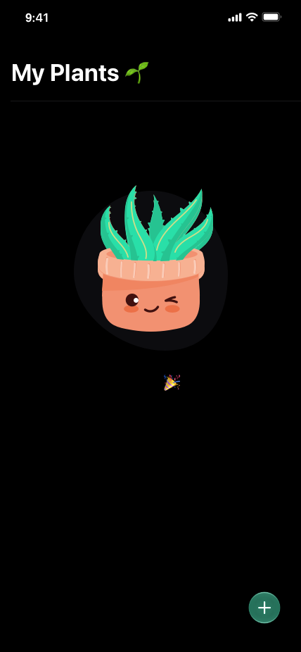

# Planto 🌱

Planto is a modern, intuitive SwiftUI app that helps you care for your houseplants, track daily watering progress, and receive scheduled reminders.

---

## 📱 App Screens | أهم واجهات التطبيق

<p align="center">
  
  
  
  
</p>

| 1. Start Journey (Onboarding) | 2. Plant List & Progress | 3. Set Reminder (Sheet) | 4. All Done! 🎉 |
| :---: | :---: | :---: | :---: |
| واجهة البداية والترحيب | قائمة النباتات مع شريط الإنجاز | نموذج إضافة وتعديل التذكير | شاشة اكتمال الري اليومي |

---

## ✨ Features | المميزات

- **Add & Edit Plants**: Set plant name, room (Living Room, Kitchen, Bedroom, etc.), light needs, and watering frequency/volume.
- **Daily Progress Tracking**: Visual progress bar updating dynamically as you water each plant (`X of your plants feel loved today ✨`).
- **All Done Celebration 🎉**: Playful celebration screen with mascot when all plants are watered.
- **Local Notifications**: Custom local reminder notifications powered by `UserNotifications`.
- **Swipe Actions**: Fast swipe gestures for deleting plant reminders.
- **Modern iOS Design**: Styled for Dark Mode with custom typography, clean chips, and Liquid Glass aesthetics.

---

## 🏗️ Architecture

The project follows a clean and lightweight **MVVM** architecture:

```text
MyApp/
├── Models/        # Plant model and option enums (Room, Light, WateringDays, WaterAmount)
├── ViewModels/    # PlantStore: state management, local persistence, actions
├── Views/         # SwiftUI views organized by feature
│   ├── Onboarding/  # OnboardingView
│   ├── PlantList/   # PlantListView, PlantRow, AllDoneView
│   ├── Reminders/   # Remindersheet
│   └── Shared/      # HeaderView, Components (Theme, Mascot, Chip, PlantProgressBar)
└── Services/      # NotificationManager for scheduling reminders
```

---

## 💾 Local Storage

Plant reminders are encoded as JSON and stored locally using `UserDefaults` under key `plants_v1`, ensuring persistent data across app launches without requiring an external database.

---

## 🔔 Notifications

Local notifications are managed via `NotificationManager` using Apple's `UserNotifications` framework. When adding a plant, a reminder is scheduled based on the selected watering schedule, with initial permission handling.

---

## 🛠️ Requirements

- macOS Sonoma / Sequoia
- Xcode 16+
- iOS 18+

---

## 🚀 How to Run

1. Clone or open the repository in Xcode (`Untitled Project.xcodeproj`).
2. Select an iOS Simulator (e.g. iPhone 16 / iPhone 17) or a physical device.
3. Press **Run** (`⌘R`).
4. Allow notifications when prompted to test reminder notifications.
