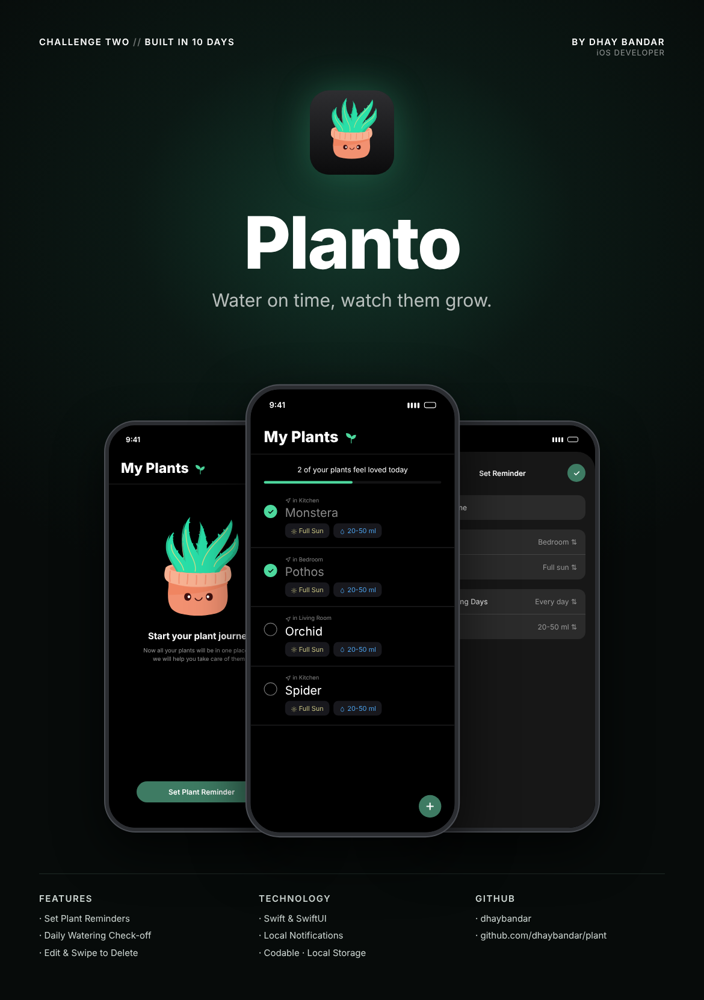
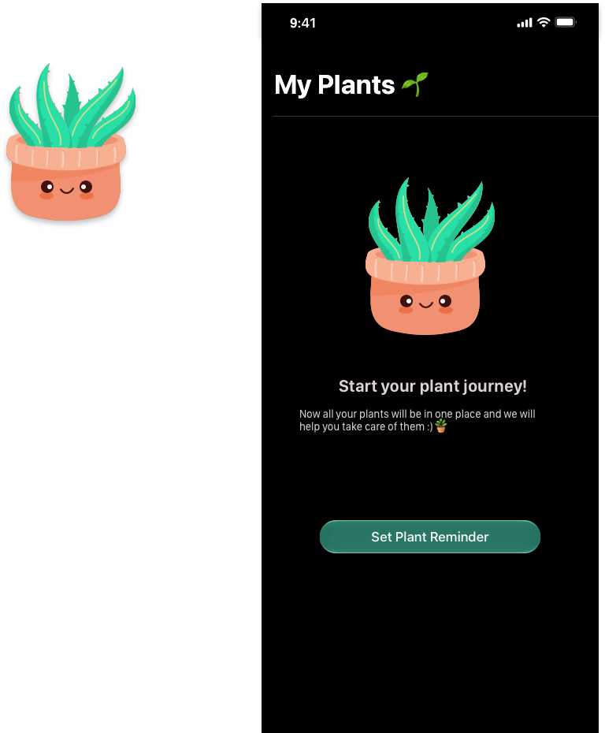
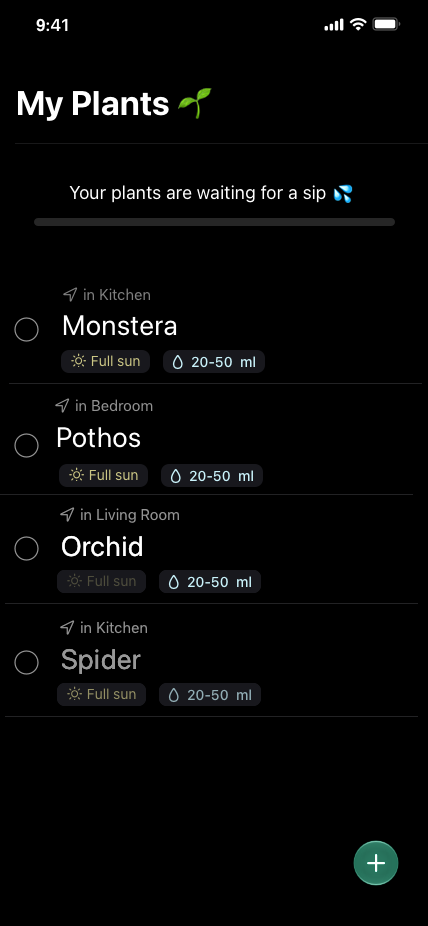

# Planto 🌱

<p align="center">
  
</p>

Planto is an iOS SwiftUI app designed to help plant lovers track their houseplant care routine, monitor daily watering progress, and receive timely local notifications.

---

## 📱 Screenshots

<p align="center">
  
  
  
  
</p>

---

## 🌿 About

An individual project built in 10 days as part of an iOS coding challenge. Starting from a ready-made UI design, I brought the concept to life with native SwiftUI, modern iOS components, and smooth animations.

---

## ✨ Features

- **Plant Care Reminders:** Add plants with customized location/room, light level, watering interval, and water amount.
- **Track Progress:** Mark plants as watered for today and watch the daily progress bar update in real-time.
- **Celebration State:** Shows an "All Done! 🎉" celebration screen once all daily watering tasks are completed.
- **Local Notifications:** Automated reminders via `UserNotifications` tailored to each plant's watering schedule (includes an instant 3-second demo notification for easy testing in debug builds).
- **Edit & Swipe-to-Delete:** Easily update reminder details or swipe to delete a plant.
- **Modern iOS Experience:** Uses Liquid Glass (`.glassEffect`) for the action button.
- **Adaptive UI:** Full automatic support for both **Light Mode** and **Dark Mode**.

---

## 🧠 Challenges & What I Learned

- **Pixel-Perfect UI:** Translating design specifications into code with strict attention to spacing, colors, custom tags, typography, and interactive sheets.
- **Notification Deduplication:** Resolved an issue where dual alerts appeared by isolating in-app alerts from scheduled system notifications, ensuring clean, single-delivery notifications.
- **Adaptive Appearance:** Tuned contrast, background layers, and component colors across both Light and Dark appearances.

---

## 🏗️ Architecture

The project follows a clean **MVVM (Model-View-ViewModel)** structure:

```text
plant/
├── Models/        # Plant data struct and selectable enums (Room, Light, WateringDays, WaterAmount)
├── ViewModels/    # PlantStore: Central state management, UserDefaults persistence, and business logic
├── Views/         # SwiftUI screens, sheets, and reusable components
│   ├── App/
│   ├── Onboarding/
│   ├── PlantList/
│   ├── Reminders/
│   └── Shared/
└── Services/      # NotificationManager: UNUserNotificationCenter scheduling and permissions
```

---

## 💾 Local Storage

Plant entries are serialized to JSON and stored locally using `UserDefaults` under the key `plants_v1`, keeping user data persistent across app launches without requiring an external backend.

---

## 🔔 Notifications

- **Routine Reminders:** Calculated using `UNTimeIntervalNotificationTrigger` based on the selected watering interval.
- **Instant Test Trigger:** Automatically schedules a test notification 3 seconds after adding a new plant in debug mode (`#if DEBUG`) for quick verification.

---

## ⚠️ Known Limitations

- **Notification Recalculation on Water Action:** Toggling a plant as watered records the action for the current day, but does not cancel or postpone the next scheduled notification trigger.
- **Periodic Schedule Anchor:** Recurring reminders are triggered at intervals anchored to when the reminder was scheduled rather than a fixed daily hour.
- **Local-Only Storage:** Plant data is persisted locally via `UserDefaults` and does not currently synchronize across multiple devices or iCloud.
- **Daily Checklist Scope:** Progress tracking evaluates whether each plant in the collection has been marked as watered today, following the original challenge design.

---

## 📋 Requirements

- iOS 26.0+
- Xcode 26.0+
- Swift 6 / SwiftUI

---

## 🚀 How to Run

1. Clone the repository:
   ```bash
   git clone https://github.com/dhaybandar/plant.git
   ```
2. Open `plant.xcodeproj` in Xcode.
3. Select an iOS Simulator or a connected device.
4. Press **Run** (`⌘R`).
5. Allow notification permissions when prompted to experience the reminders.

---

## 🛠️ Built With

- **SwiftUI** & **Combine**
- **UserNotifications Framework**
- **UserDefaults** (Local Persistence)

---

## 👤 Author

**Dhay Bandar**  
GitHub: [@dhaybandar](https://github.com/dhaybandar)
